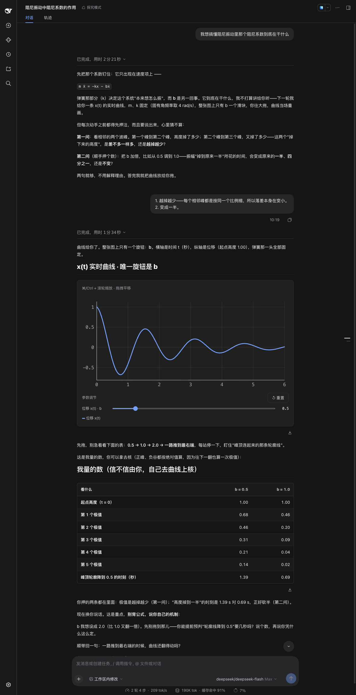

# Inquiry Mode

[简体中文](README.md) · English

An agent preset for DSH: turn a concept that has **a variable you can adjust and an outcome you can watch** into a task the learner **operates by hand**.



The screenshot is one complete turn from a real session: the model asks for **two falsifiable predictions in plain prose**
("before you touch anything you have to commit to a guess — and say it out loud, guessing silently doesn't count"),
and only after the learner answers does it hand over the slider-driven live curve — exactly one thing on the chart is movable.
The table below the chart is not decoration: it is the fallback for when the chart fails to render.

**The unit is a single interactive task, not a course.** No curriculum tree, no progress tracking, no question bank. It is the mode you switch into when you want to get your hands on one specific concept.

> **Language note.** The preset's display name in the DSH mode list is Chinese — `探究模式` — and the teaching skill it loads is written in Chinese. The preset still works in any conversation language (the model replies in whatever language you use, and translates the parts it shows you), but the mode label and the internal skill text are Chinese. This README is the English rendering of [the Chinese one](README.md).

---

## How it differs from what already exists

| | The usual approach | Inquiry Mode |
| --- | --- | --- |
| What you get | Explanation + questions | **Something you can drag** + a prediction you must state |
| Mechanism | Read → answer → get graded | Predict → manipulate → observe → **reconcile** → say the rule yourself |
| Done when | You answer correctly | **You state the relationship in your own words** |
| Grading | LLM or rule-based | **None** — the observation is a fact; whether you understood it is yours to say |

Almost every "learning mode" product converges on **explanation + multiple choice + spaced repetition**. The difference here is **Shape A: dragging your way to intuition** (section 2 below), not yet another quiz app.

---

## Install

```bash
# 1) Install a fence renderer (optional, but strongly recommended — without one there is nothing to drag)
dsh plugin --profile web add @changfenhuang/dsh-genui

# 2) Install this plugin
dsh plugin --profile web add github:GrowingPPP/dsh-inquiry-preset
```

Replace `web` with the profile you actually use (the desktop profile is `desktop`; if unsure, run `ls ~/.dsh/profiles`).

Then **start a new session** and pick **探究模式** in the mode list. If it is not there, restart the DSH host once — plugin-row changes sometimes need a restart to reach a running instance.

### About the renderer

It is **not a hard dependency**. Without a renderer, `dsh-ui` fences fall back to plain code blocks, and the task continues along the degradation path written into SKILL.md (ask for the number instead, list the options, work it out by hand).

But **Shape A — a function plot with parameter sliders that redraws as you drag — is this product's flagship move**, and it is unavailable without a renderer. So install at least one; any renderer that implements `dsh-ui` fences will do, and the one above is the one this project was tested against.

**Local development**: install the bundle from the repository directory instead (`plugin_manager install_bundle`, with `target` set to the absolute path of this repo root) so your edits reach sessions directly. A `github:` install pins you to one commit.

---

## Permissions and compatibility

**What this preset mounts, and what it does not** (all checkable in `cordis.patch.yml`):

| | Contents |
| --- | --- |
| Tools registered | `skill` (loads skills on demand), `web_search` (web search) |
| **Not registered** | any shell, file read/write, subagent, or automation tool |
| **Also not registered** | `web_fetch` (configured with `fetch: false` — search only, no page fetching) |

In other words: **installing it does not open any new execution surface in your session.** It changes *teaching behaviour*, not *what the agent can do* — the tool surface inside this preset is **narrower** than the standard preset's.

**External services**: only `web_search` reaches out, and it goes to whatever search service you have configured. Nothing else contacts any external endpoint. Unless you deliberately switch to another mode, it will not touch your files or run commands.

**Compatibility**:

- **DSH**: verified end to end on **both `0.2.1-alpha.2` and `0.2.0-rc.2` (the official `latest`)**.
  Every dependency is an official package
  (`dsh-persona` / `dsh-skill-filesystem` / `dsh-tool-skill` / `dsh-tool-web` / `dsh-compaction-*`),
  and no community plugin is required.

  Every configuration surface this preset uses was compared item by item across the two versions:
  the `agent-preset` Config fields, `persona.prefix`, `skill-filesystem.customSkillDirs`,
  `tool-web.fetch`, the three compaction packages' Config, and the `!!js` evaluator
  (`with (ctx) { return eval(expr) }`) — **all six identical**. A full install was also performed on
  `0.2.0-rc.2`, confirming the composition tree is correct and the host boots with **zero warnings**.

  Note: the official `latest` is `0.2.0-rc.2`, while `0.2.1-alpha.*` is a **newer alpha line** —
  the two are not the same codebase, and both were tested.
- **Platform**: only tested on **macOS + the Web profile**. Other platforms are unverified (the preset itself is declarative, so it should be portable in principle).
- **Rendering**: the flagship shape needs a renderer implementing `dsh-ui` fences; without one it degrades to a text-only task. See the previous section.
- **Known limitations**:
  - The preset's display name and the skill text are Chinese
  - Chart components **may render blank** (hit twice in testing), which is why Shape B always ships a numeric table as a fallback
  - `plot`'s expression grammar is narrow: the independent variable must be `x`, multiplication must be written with `*`, and parameters must be single letters — **write it wrong and nothing is drawn, with no error**
  - If your profile mounts only `@deepseek-ai/dsh-base` (for example a minimal profile hand-built with
    `dsh plugin add`), the preset stays at `pending (waiting for service: agentPresets)` — that service is
    provided by **`@deepseek-ai/dsh-web-app`**, which `dsh-base` does not include. A profile created the
    normal way by `dsh web` has both bundles and is unaffected

---

## How to use it

Switch to Inquiry Mode and name a relationship you want to understand:

> I want to understand what the damping coefficient in damped oscillation actually does

It should **first ask you for a specific, falsifiable prediction** ("you predict: as d goes from 0.2 to 1.5, what happens to the waveform?"), and **only then** hand you something with a slider — and finally ask you to state the rule yourself.

If it opens with a plot, or just starts explaining — that is a bug, not the design.

---

## Design notes

### The core loop (`skills/inquiry-task/SKILL.md`)

**Predict → manipulate → observe → reconcile → name**

Two of those are non-negotiable:

- **No prediction, no inquiry.** Ask for a specific, falsifiable prediction, **and make them say it out loud** — the commitment comes from having to take a position *before* seeing the result. If they cannot produce a prediction at all, that signals missing prerequisites: go back and teach the minimum necessary, rather than forcing a task.
- **Do not let reconciliation slide.** If they predicted wrong, first ask *how they reasoned*, and fix that reasoning. Stating the correct conclusion immediately just buries the wrong model they had exposed.

### Four task shapes

| Shape | Round trips | Use when |
| --- | --- | --- |
| **A Live function plot** | **Zero** | The flagship. The `plot` component has built-in parameter sliders; the curve redraws as you drag |
| **B Precomputed family** | Zero | Discrete/data-shaped: multi-series charts, tabs, locally filterable tables |
| **C Single probe** | One | When the state cannot be written as an expression and you only need to test one specific judgment |
| **D Local self-check** | Zero | Closing only — **never the main course** |

Shape A costs zero round trips because the renderer's `plot` component builds the parameter sliders in (`params`, live redraw, locked y-axis, `animateTo` animation). That is the renderer's feature, not ours.

### Six hard rules

1. **Never hold the turn** — render the fence and end your turn. The learner's input comes back next turn through the normal input box.
2. **No spoilers** — no conclusion may appear anywhere before they observe it, including component titles and `explanation` fields.
3. **Only the manipulable object goes in the fence; teaching prose stays outside it** (so the task stays readable when degraded).
4. **No renderer? Ask for the number** — a degradation path must always exist.
5. **Do not force components in** — if a sentence explains it, do not draw it.
6. **Teach the minimum necessary concept first, then give the task.**

`skills/inquiry-task/references/anti-patterns.md` lists 8 anti-patterns; the first two (idle turns, spoilers) are veto-level.

### Why "never wait" is rule #1

This was learned from a real failure: **someone did build interactive learning activities this way, and later cut the entire pipeline**, for exactly this reason — the old `Question → Reveal` two-tool structure "naturally duplicates turns, and leaves the model's turn running while it waits for the user".

A fence is part of the answer, not a tool call. The moment a model "waits", its turn hangs in the running state until the user clicks — the UI says it is thinking, while it is really just idling. So: **render, end the turn, and hand the answer back to the ordinary input box.**

---

## Layout

```
package.json                         dsh-inquiry-preset (bundle root)
index.js                             entry stub: the marketplace preflight requires an entry file
cordis.patch.yml                     preset declaration (persona + 4 plugin groups)
skills/inquiry-task/
├── SKILL.md                         core loop + hard rules
└── references/
    ├── task-shapes.md               four shapes + expression constraints + degradation
    └── anti-patterns.md             8 anti-patterns

tools/probe-skill-dir.mjs            per-link probe for skill discovery
docs/demo.png                        the screenshot above
VERIFICATION.md                      verification evidence
AGENTS.md                            maintenance conventions for humans/AI agents (read before changing this repo)
```

When diagnosing "the skill does not show up", run the probe first — every link in that chain fails **silently** (a wrong path returns an empty list; malformed frontmatter only logs a warning):

```bash
node tools/probe-skill-dir.mjs      # exit code 0 = all checks pass
```

### Two constraints you must not break (easy to trip over when repackaging)

1. **Do not add an `exports` field to `package.json`.** The skill-directory path is resolved through
   `createRequire(baseUrl).resolve('dsh-inquiry-preset/package.json')`, and once `exports` exists,
   subpath access is blocked by default and throws `ERR_PACKAGE_PATH_NOT_EXPORTED` — the visible
   symptom is that **the skill silently disappears**. If you must add one, explicitly export
   `"./package.json": "./package.json"` alongside it.
2. **Do not delete `index.js`.** Nothing ever imports it, but the marketplace's pre-install preflight
   resolves an entry file from the package root (`exports["."]` → `main` → falling back to `index.js`);
   if it finds none, the package is rejected as "missing entry file".

---

## Status

**Verified end to end in a real session.** Three layers were checked: assembly (`preset-inquiry` → `active`,
composition tree correct), static (skill name and frontmatter valid, every persona variable registered,
embedded specs syntactically valid), and end to end (the skill is loaded and influences model behaviour,
the model asks for a prediction before drawing, and a `dsh-ui` fence renders as a curve plot with parameter
sliders).

The first real-session test surfaced no functional problems.

See [VERIFICATION.md](VERIFICATION.md) for details.
